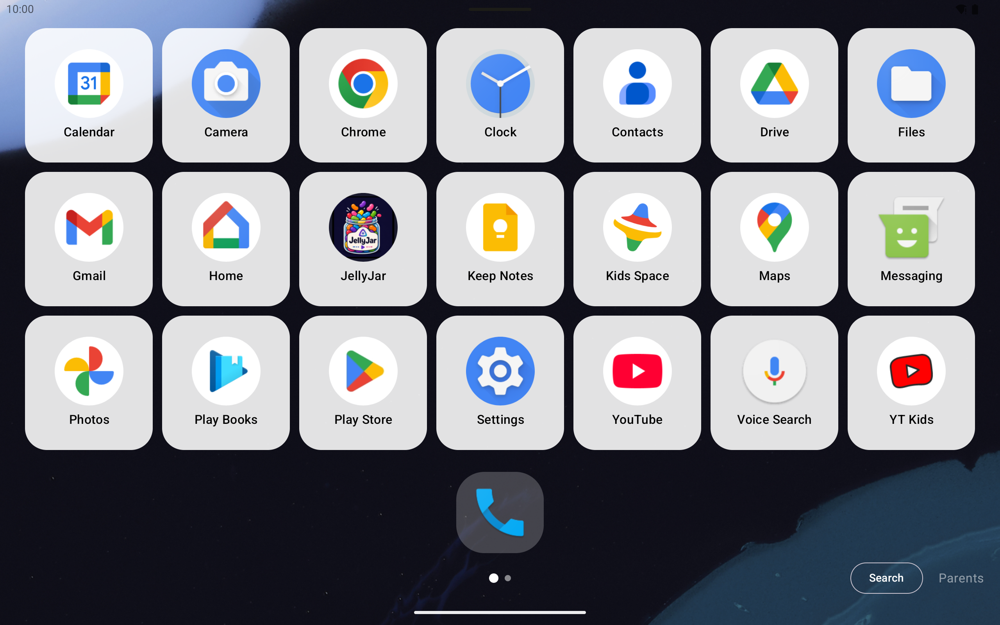
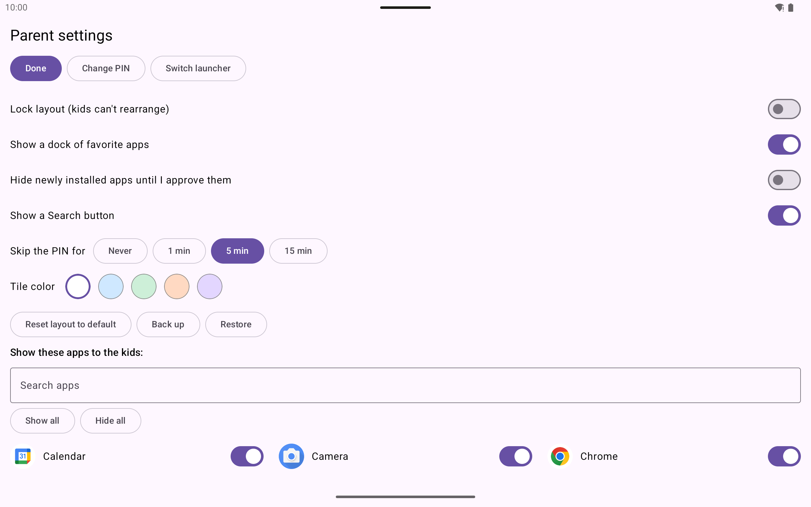

# Cubby

A simple Android home-screen launcher for kids' tablets. Runs alongside Google Family Link:
Family Link does the enforcement (app approval, time limits), this does the friendly home screen.

| Kid home screen | Rearranging | Parent settings |
|---|---|---|
|  |  |  |

## Install
- Download the APK from the latest [release](../../releases), or build it yourself (below), and sideload it.
- Press Home and choose "Cubby" as the default home app (or use "Switch launcher" in the parent screen).
- First run asks you to create a parent PIN, then shows a short welcome with setup steps.

## Build
Requires JDK 17 and Android SDK platform 37 (Android Studio fetches both).

1. Open this folder in Android Studio, or use the command line:
2. `./gradlew testDebugUnitTest assembleDebug` (debug APK: `app/build/outputs/apk/debug/app-debug.apk`).
3. `./gradlew assembleRelease` builds the release variant.

GitHub Actions builds and tests every push/PR, and attaches an APK to each published release.
Minimum Android version is 10 (API 29).

## Features
**For kids**
- Big-icon grid of tiles that fits the screen (no scrolling), paged with swipes; refreshes when apps
  are installed, updated or removed.
- Rearrange: long-press an app, then drag to reorder, drop onto another app to make a folder, or hold
  at the screen edge to move it to the next (or a new) page. Folders hold apps only.
- Optional dock: a compact pill of up to 6 favorite apps at the bottom that apps can be dragged into.
- Optional Search button to find apps by name.
- Tile color presets (white, sky, mint, peach, lavender).

**For parents** (long-press the faint "Parents" text at the bottom right, then enter the PIN)
- Choose which apps the kids can see; show all / hide all, with search.
- Hide newly installed apps until approved (they show as "New" in the list).
- Lock the layout so kids can't rearrange, or reset it to one alphabetical page.
- Back up and restore layout, hidden apps and settings to a file (the PIN is never included).
- Change the PIN, "Switch launcher" shortcut, and choose how long the parent screen skips the PIN
  after you leave it (never, 1, 5 or 15 minutes; resets on reboot).

**Safety**
- PIN stored as a salted PBKDF2 hash; escalating lockout after 5 wrong tries that survives clock
  changes and restarts.
- A PIN must exist before the launcher is usable.
- The parent screen, PIN dialogs and edit mode close themselves whenever the launcher is left.
- Apps that are hidden, disabled, suspended or briefly missing keep their place in the layout.
- Layout is stored per tablet; there is no sync.

## Known limits
- This is a soft layer. Kids can change the default launcher in Android Settings unless Family Link
  or the device blocks that. Hiding an app doesn't stop it opening from notifications or links.

## Planned
- Optional Home Assistant layer: per-kid mode (normal / homework / bedtime / locked) read from an
  HA entity via a webhook or a limited HA user, falling back to normal if HA is unreachable.

## Development
See [AGENTS.md](AGENTS.md) for the code layout, design notes and emulator testing tips.
